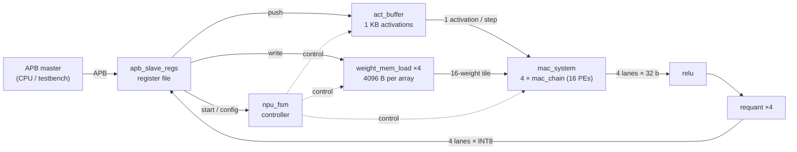

# Digital NPU Fallback Accelerator

A small INT8 neural-network accelerator written in SystemVerilog, controlled over an
AMBA APB slave interface. It computes fully-connected (matrix-vector) layers on
**4 MAC arrays × 16 processing elements (64 MACs)**, then applies ReLU and
INT8 requantization in hardware. It was built to run a keyword-spotting model
as a fallback path when no larger NPU is available.

## Highlights

- **Datapath:** 4 MAC arrays × 16 PEs, signed INT8 operands, 32-bit accumulators,
  plus a reduced-precision INT4 mode selectable at run time.
- **Custom arithmetic:** each PE uses a hand-built 8×8 signed **Baugh-Wooley
  multiplier** (8:2 carry-save adder tree + ripple-carry adder) instead of the `*` operator.
- **Weight loading:** weights are shifted into per-PE registers through a shift chain,
  then captured and held while an activation is broadcast to every PE.
- **Post-processing:** ReLU (bypassable) and requantization:
  `out = saturate_int8(((acc − offset) × scale) >>> shift)` (bypassable).
- **Host interface:** APB slave register file: configuration, activation push,
  weight write, status polling and a 64-entry result window.

## Results

- Ran a **12-class keyword-spotting** model (TensorFlow/Keras, quantized with
  TensorFlow Lite INT8) on the RTL at **90% accuracy**.
- Hardware outputs are **bit-exact (100%)** against the software golden model.
<!-- TODO: add synthesis / STA / place-and-route results (technology, clock, area, WNS/TNS, power) once the physical implementation is done -->

## Architecture



### How one run works

For a layer with `K` inputs (`RED_LEN = K`), one `start` computes 64 outputs:

1. **Reduction loop** (repeated `K` times, step `k`):
   - each array shifts its 16-weight tile `W[k·16 … k·16+15]` into the PE chain;
   - the tile is captured into the PE weight registers;
   - activation `x[k]` is read from `act_buffer` and broadcast to all 64 PEs;
   - every PE accumulates `acc += x[k] × w`.
2. **Output phase:** the 16 accumulators of each array are shifted out one by one
   through ReLU and requantization (4 lanes in parallel) into the result window.
3. `STATUS.done` is set; the activation read pointer advances by `K`, so the next
   run consumes the next activation vector.

PE `p` of array `a` therefore holds `Σₖ x[k] · Wₐ[k·16 + p]`.

## Register map

All registers are 32 bits wide and word-aligned.

| Offset | Name | Access | Description |
|---|---|---|---|
| `0x00` | `CTRL` | R/W | bit 0 `start` (write 1 to start, reads 0); bit 1 `precision` (0 = INT8, 1 = INT4) |
| `0x04` | `STATUS` | R | bit 0 `busy`; bit 1 `done` (sticky, cleared on read or on `start`) |
| `0x08` | `RED_LEN` | R/W | reduction length `K` (number of inputs) |
| `0x0C` | `BYPASS` | R/W | bit 0 ReLU bypass; bit 1 requant bypass |
| `0x10` | `RQ_OFFSET` | R/W | requant offset (signed 32-bit) |
| `0x14` | `RQ_SCALE` | R/W | requant scale (signed 16-bit, reset value 1) |
| `0x18` | `RQ_SHIFT` | R/W | requant arithmetic right shift (6-bit) |
| `0x1C` | `ACT_PUSH` | W / R | write: push one INT8 activation; read: bit 0 = buffer ready (not full) |
| `0x20` | `WGT_SEL` | R/W | selects the MAC array (0–3) for weight writes |
| `0x24` | `WGT_ADDR` | R/W | weight memory address |
| `0x28` | `WGT_DATA` | R/W | write: store one INT8 weight at `WGT_ADDR` of array `WGT_SEL` |
| `0x40`–`0x13C` | `RESULT[0..63]` | R | INT8 results, sign-extended; index = `pe × 4 + array` |

`PREADY` is always 1 (no wait states) and `PSLVERR` is always 0.

### Programming sequence

1. For each array, write `WGT_SEL`, then `WGT_ADDR` + `WGT_DATA` for every weight.
2. Push `K` activations through `ACT_PUSH`.
3. Configure `RED_LEN`, `BYPASS`, `RQ_OFFSET`, `RQ_SCALE`, `RQ_SHIFT`.
4. Write `CTRL = 0x1` (INT8) or `0x3` (INT4).
5. Poll `STATUS` until `done = 1`, then read `RESULT[0..63]`.

## Parameters (`npu_apb_top`)

| Parameter | Default | Meaning |
|---|---|---|
| `data_width` | 8 | activation / weight width |
| `acc_width` | 32 | accumulator width |
| `out_width` | 8 | output width after requant |
| `num_pe` | 16 | PEs per MAC array |
| `num_array` | 4 | number of MAC arrays |
| `act_depth` | 1024 | activation buffer depth (bytes) |
| `wgt_depth` | 4096 | weight memory depth per array (bytes) |
| `cnt_width` | 16 | width of `RED_LEN` |
| `paddr_width` | 12 | APB address width |

## Repository structure

```text
rtl/
├── filelist.f              compile order (leaf → top)
├── top/
│   ├── npu_apb_top.sv      top level: APB slave + NPU core
│   ├── apb_slave_regs.sv   register file and result window
│   ├── npu_ctrl_top.sv     NPU core: buffers, MAC system, ReLU, requant
│   └── npu_fsm.sv          main controller FSM
├── mem/
│   ├── act_buffer.sv       activation buffer
│   └── weight_mem_load.sv  weight memory + tile loader (shift chain)
├── mac/
│   ├── mac_system.sv       4 MAC arrays
│   ├── mac_chain.sv        one array: 16 PEs + output shift register
│   └── mac_unit.sv         one PE: weight registers, multiplier, accumulator
├── arith/
│   ├── mulBW.sv            8×8 signed Baugh-Wooley multiplier
│   ├── CSA8to2.sv          8:2 carry-save reduction tree
│   ├── CSA3to2.sv          3:2 carry-save adder
│   ├── RCA.sv              ripple-carry adder
│   └── fa.sv               full adder
└── post/
    ├── relu.sv             ReLU (bypassable)
    └── requant.sv          offset / scale / shift / saturate
```

## Build

Compile and elaborate the RTL with Cadence Xcelium:

```bash
xrun -sv -f rtl/filelist.f -top npu_apb_top -elaborate
```

The file list works with other simulators too (for example `vlog -sv -f rtl/filelist.f` in Questa/ModelSim).

## Author

Ngo Tran Duong Nam, Electronics and Telecommunication, HCMC University of Technology (HCMUT).
